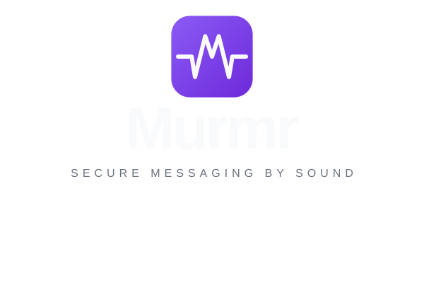

<p align="center">
  <picture>
    <source media="(prefers-color-scheme: dark)" srcset="https://raw.githubusercontent.com/sirventai/murmr/main/docs/assets/lockup_vertical_color.svg">
    
  </picture>
</p>

<h1 align="center">Murmr</h1>

<h3 align="center">Zero-Trust End-to-End Encrypted Messaging via Acoustic Out-of-Band Key Exchange</h3>

<p align="center">
  A next-generation privacy-first messaging architecture that completely eliminates <b>Trust-On-First-Use (TOFU)</b>.<br>
  Cryptographic identities and session keys are negotiated physically over air using <b>near-ultrasound sound waves (15–19 kHz)</b>,<br>
  and subsequent communications are routed blindly through an in-memory <b>zero-knowledge relay server</b>.
</p>

<p align="center">
  <a href="https://opensource.org/licenses/MIT"></a>
  <a href="https://kotlinlang.org"></a>
  <a href="#projects-in-the-murmr-ecosystem"></a>
  <a href="#academic-attribution"></a>
  <a href="#security--cryptographic-invariants"></a>
  <a href="#how-murmr-works"></a>
</p>

---

<table align="center">
  <tr>
    <td align="center" width="33%"><h2>0% PII</h2>No telephone numbers, no emails, no central account directories. Identities are ephemeral local UUIDs.</td>
    <td align="center" width="33%"><h2>15 – 19 kHz</h2>Near-ultrasonic physical carrier for direct device-to-device Out-of-Band (OOB) key negotiation.</td>
    <td align="center" width="33%"><h2>Zero-Trust</h2>Initial key exchange never touches any server, eliminating TOFU and Man-in-the-Middle (MITM) attacks.</td>
  </tr>
  <tr>
    <td align="center"><h2>5 Emojis SAS</h2>Visual Short Authentication String with 25 bits of entropy ($p_{\text{collision}} < 1 / 33{,}554{,}432$).</td>
    <td align="center"><h2>AES-256-GCM</h2>Authenticated payload encryption with directional ratcheting and granular session expiration.</td>
    <td align="center"><h2>Zero-Knowledge</h2>Stateless in-memory relay server with 0 MB disk persistence and automatic mailbox draining.</td>
  </tr>
</table>

---

## 🚀 Projects in the Murmr Ecosystem

The Murmr ecosystem is partitioned into two decoupled, standalone open-source repositories:

<table align="center" width="100%">
  <tr>
    <td width="50%" valign="top">
      <h3>📱 <a href="https://github.com/sirventai/murmr-app">Murmr App</a></h3>
      <p><b>Cross-platform client application for Android, Desktop JVM (macOS, Windows, Linux), and iOS.</b></p>
      <ul>
        <li><b>UI Engine:</b> Compose Multiplatform with Material 3 design system.</li>
        <li><b>Acoustic Physical Layer:</b> Real-time FFT spectrogram and Slotted ALOHA half-duplex arbitration (15–19 kHz).</li>
        <li><b>Cryptographic Core:</b> Curve25519 (X25519) ECDH key agreement, HKDF-SHA256, 5-emoji SAS visual anti-MITM verification, AES-256-GCM cipher.</li>
        <li><b>Offline Storage:</b> SQLDelight SQLite encrypted local storage and hardware-backed keys (AndroidKeyStore TEE / iOS Keychain).</li>
        <li><b>Privacy Tenet:</b> Zero personal data, no address book access, anonymous local UUIDs.</li>
      </ul>
      <p align="center">
        <a href="https://github.com/sirventai/murmr-app"><b>👉 View Murmr App Repository</b></a>
      </p>
    </td>
    <td width="50%" valign="top">
      <h3>⚡ <a href="https://github.com/sirventai/murmr-relay-server">Murmr Relay Server</a></h3>
      <p><b>High-performance, zero-knowledge asynchronous message routing daemon.</b></p>
      <ul>
        <li><b>Engine:</b> Kotlin 2.0 with Ktor (CIO/Netty) and non-blocking coroutines.</li>
        <li><b>Zero-Knowledge Architecture:</b> Treats all message envelopes as blind, opaque byte arrays. Zero access to session keys or plaintext.</li>
        <li><b>Zero Disk Persistence:</b> 100% in-memory concurrent FIFO mailbox. No databases to subpoena, breach, or leak.</li>
        <li><b>Delivery Pipeline:</b> Sub-millisecond persistent WebSocket push streaming with HTTP REST offline fallback and automatic mailbox draining.</li>
        <li><b>Ultra-Light Deployment:</b> Minimal Alpine container (~50 MB) using a customized JRE created via <code>jlink</code> (80–150 MB RAM).</li>
      </ul>
      <p align="center">
        <a href="https://github.com/sirventai/murmr-relay-server"><b>👉 View Murmr Relay Server Repository</b></a>
      </p>
    </td>
  </tr>
</table>

---

## 🔍 How Murmr Works

```
                        +-----------------------------------------------+
                        |        PHYSICAL ACOUSTIC CHANNEL (OOB)        |
                        |      (15 - 19 kHz Near-Ultrasound Waves)      |
                        |                                               |
                        |  1. Slotted ALOHA Half-Duplex Arbitration     |
                        |  2. Direct Curve25519 Public Key Exchange     |
                        |  3. Visual SAS Emoji Verification (25 bits)   |
                        +-----------------------+-----------------------+
                                                ^
                                                |
                       +------------------------+------------------------+
                       |                                                 |
              +--------+--------+                               +--------+--------+
              | Device A Client |                               | Device B Client |
              |   (murmr-app)   |                               |   (murmr-app)   |
              |  - Local UUID   |                               |  - Local UUID   |
              |  - Secure Vault |                               |  - Secure Vault |
              +--------+--------+                               +--------+--------+
                       |                                                 |
                       |             +---------------------+             |
                       +------------>| Murmr Relay Server  |<------------+
                                     | (murmr-relay-server)|
                                     | - Blind Opaque Pipe |
                                     | - 0 Disk Writes     |
                                     | - Real-time WS Push |
                                     +---------------------+
```

### 1. Physical Acoustic Handshake
When two users meet in person, their devices negotiate keys directly through the air using ultrasonic frequencies (15–19 kHz). A custom Slotted ALOHA protocol arbitrates half-duplex collisions. Both devices derive 5 emojis from the resulting ECDH secret; verifying that both screens display matching emojis provides physical mathematical proof that no local sound injection occurred ($p_{\text{collision}} < 1 / 33{,}554{,}432$).

### 2. Zero-Knowledge Remote Messaging
Once paired, devices communicate over any internet connection. The relay server routes envelopes containing opaque ciphertext. Because the relay server possesses no keys and persists no data to disk, conversation metadata and plaintexts remain completely unobservable.

---

## 🛡️ Security & Cryptographic Invariants

| Invariant | Implementation | Guarantees |
|---|---|---|
| **Identity Privacy** | Pure UUIDv4, hardware keystore | Eliminates correlation with phone numbers or email addresses |
| **Acoustic Out-of-Band** | 15–19 kHz MFSK / Chirp audio | Eliminates TOFU; remote network attackers cannot reach the physical acoustic channel |
| **Active MITM Defense** | 5-Emoji SAS (Short Auth String) | 25 bits of entropy over a curated 32-emoji alphabet ($p < 0.000003\%$) |
| **Payload Encryption** | AES-256-GCM (128-bit tag, 96-bit IV) | Confidentiality and authenticated ciphertext integrity per message |
| **Forward Secrecy** | Directional HMAC-SHA256 ratcheting | Immediate memory zeroing; past session states cannot be recovered |
| **Blind Transport** | In-memory ephemeral mailbox (TTL = 7d) | Zero disk persistence; drained messages disappear from RAM instantly |

---

## 🎓 Academic Attribution

**Murmr** was researched, engineered, and defended as a **Final Degree Project (B.S. Thesis)** in **Computer Engineering** at the **Universitat Oberta de Catalunya (UOC)**.

- **Author:** Pablo Sirvent Jiménez
- **Academic Institution:** Universitat Oberta de Catalunya (UOC)
- **Degree:** Bachelor of Science in Computer Engineering
- **Year:** 2026

If you reference or cite Murmr in academic work, please use the following citation format:

```bibtex
@software{sirvent2026murmr,
  author = {Sirvent Jiménez, Pablo},
  title = {Murmr: Zero-Trust End-to-End Encrypted Messaging via Acoustic Out-of-Band Key Exchange},
  institution = {Universitat Oberta de Catalunya (UOC)},
  year = {2026},
  url = {https://github.com/sirventai/murmr}
}
```

---

## 📄 License

The Murmr ecosystem is open-source software licensed under the **[MIT License](https://opensource.org/licenses/MIT)**.
Copyright (c) 2026 Pablo Sirvent.
